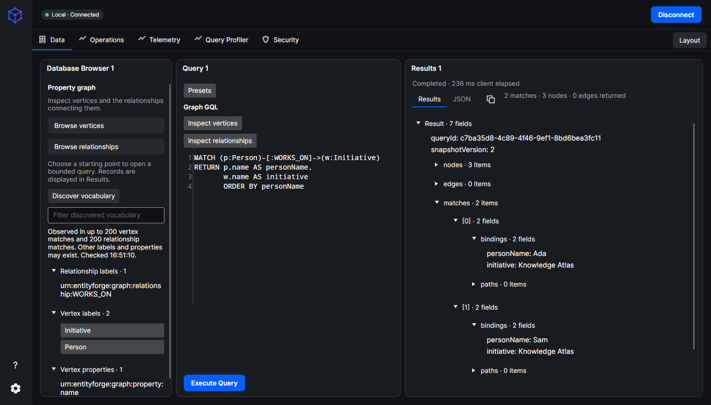

  

<h1 align="center">EntityForge</h1>

0.8 — Public Preview · <a href="CHANGELOG.md">Changelog</a>

<strong>Fast, Free Semantic Graph Database For People &amp; AI.</strong>

Turn connected data into a typed, traceable knowledge model. Explore it in Studio. Query it from your applications. Bring its context to AI.

  

<a href="docs/user/studio.md">Explore Studio</a> · <a href="docs/developer/README.md">Developer guides</a> · <a href="docs/developer/benchmark-runner.md">Reproduce benchmarks</a>

Apache-2.0 · .NET libraries · HTTP APIs · Browser-based Studio

Actual Studio interface with synthetic property-graph data. The displayed client elapsed time is a UI observation, not a benchmark.

## Give your data meaning

EntityForge DB combines connected data with explicit meaning. Its Semantic profile models concepts, typed identities, relationships and source assertions, helping you bring differently shaped source data into a consistent knowledge model while retaining where the evidence came from.

- **Model what things mean.** Use shared concepts and typed identities to describe people, products, places or your own domain without reducing everything to untyped text.
- **Explore the connections.** Match relationships, inspect results and discover the stored vocabulary in the included dark-theme Studio workspace.
- **Keep evidence attached.** Preserve source provenance alongside Semantic assertions so applications can inspect the evidence behind a value.
- **Give AI useful context.** Retrieve structured facts, relationships and source evidence for an application's LLM context. Updating that retrieved knowledge does not require retraining the model; answer quality still depends on retrieval and the application.
- **Choose the interface for the job.** Use GraphQL for schema-defined application responses, and supported GQL or SPARQL features for native matching, traversal, joins and reporting.
- **Build without licence fees.** Embed the .NET libraries or run an HTTP server with Studio. Author-owned code is Apache-2.0, free for personal and commercial use, modification and redistribution under its terms.

## Three profiles, clear contracts

Choose a profile when creating a database. Each provides its own data model and supported interfaces; switching a setting does not convert existing data.

| Profile | Best suited to | Query access |
| --- | --- | --- |
| **Semantic** | A typed knowledge model with identities, assertions and provenance | Semantic APIs and GraphQL; bounded, read-only asserted views through GQL and SPARQL |
| **Property graph** | Labelled nodes, relationships and properties | Graph APIs, GraphQL and the supported GQL query/update subset |
| **RDF** | RDF terms, triples and named graphs | RDF APIs, GraphQL and the supported SPARQL query/update surface |

Read [which query interface to choose](docs/developer/query-interfaces.md), the [language support matrix](docs/user/query-languages.md), and the [Semantic native-query limits](docs/user/semantic-native-queries.md). EntityForge does not claim complete ISO GQL or SPARQL conformance.

## Try EntityForge

Start with the [five-minute Semantic tour](docs/user/quickstart.md): one command prepares a sample database and gives you a link to explore it, with no manual import or credential setup. The [deployment guide](docs/user/deployment.md) covers portable Windows/Linux packages with Studio included and container deployment. Check the repository's Releases page for available binaries; these packaging instructions do not imply a release has already been published.

For embedded applications, follow the [.NET save, read and reopen quickstart](docs/user/dotnet-quickstart.md). To work from this checkout, use [build from source](docs/developer/building.md).

**Current status: pre-release.** Public APIs and storage formats may change before a stable release. Start with an evaluation of the documented feature set and limits for your workload.

## Performance you can inspect

EntityForge includes a [public benchmark runner](docs/developer/benchmark-runner.md) that checks results and produces **Markdown, HTML and raw JSON** reports with build identity, workload and environment details. Coverage includes all three profiles, with embedded, HTTP and opt-in distributed fixtures; coverage varies by workload and deployment.

“Fast” is workload-dependent. Measure latency, throughput and allocations on your own data and hardware, and include slower workloads and failed attempts when publishing results. The reports make EntityForge's performance observable for the named build, workload and environment; they do not establish a universal performance ranking.

## Documentation

- [DB user guide](docs/user/database.md)
- [Studio user guide](docs/user/studio.md)
- [SPARQL and Graph GQL support](docs/user/query-languages.md)
- [Install prebuilt packages, containers and deployment](docs/user/deployment.md)
- [Application developers](docs/developer/README.md)
- [FAQ and development transparency](docs/faq.md)
- [Build from source](docs/developer/building.md)
- [Architecture](docs/developer/architecture.md)
- [Graph sharding and storage layouts](docs/developer/graph-sharding.md)
- [Build packages and API documentation](docs/developer/distribution.md)
- [Component licences](LICENSING.md)

## Project structure

Production projects live under `src/Db`, `src/Studio`, `src/AppModel` and [`src/Shared`](src/Shared/README.md). Tests mirror those groups under `tests`. DB contains the engine, clients and server; Studio contains the browser UI; AppModel supplies connection and presentation services. Shared contains product-independent contracts, utilities and reusable UI components, including semantic protobuf payloads without pipeline activity contracts.

User and developer guides live in `docs`, with detailed DB references in `docs/db`. Build and validation scripts live in `eng`, and deployment configuration lives in `deploy`. Run repository commands from this directory unless a guide states otherwise.

## Open development

EntityForge is published under the **Incisive Logic** name. This repository contains EntityForge DB, Studio and their shared libraries.

See [licensing](LICENSING.md) for the perpetual Apache-2.0 grant on author-owned code and the separate third-party licence boundaries, [contributing](CONTRIBUTING.md) to get involved, the [security policy](SECURITY.md) for reporting vulnerabilities, and the [FAQ](docs/faq.md) for development transparency, including the use of AI assistance. Free software does not imply free hosting or support.
