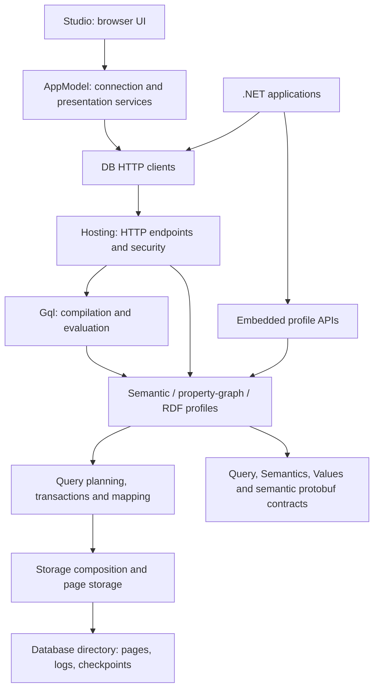
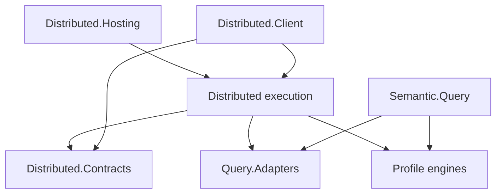
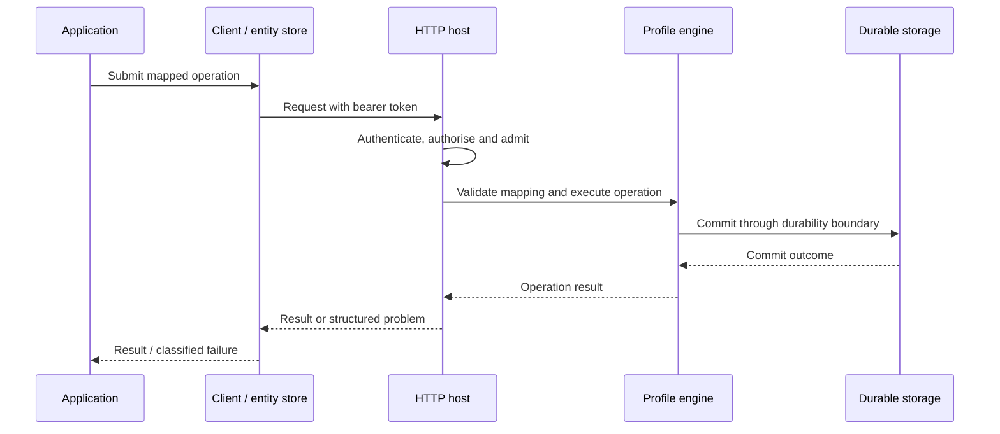
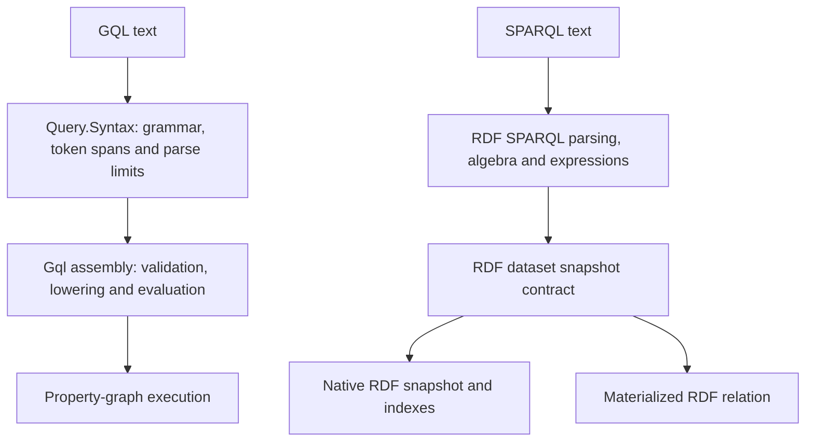

# Database architecture

EntityForge DB separates data meaning, application access, execution and persistence. Studio is an HTTP client of the database. It does not open the server's data files or embed a second database engine.

## Components and dependency direction

`EntityForge.Db.Hosting` owns process startup, recovery, endpoint registration and shutdown. The profile and engine libraries own database semantics; ASP.NET request types are not their domain model. `EntityForge.Db.Storage.Local` and `EntityForge.Db.Storage.Pages` provide local persistence. `EntityForge.Db.Storage.Composition` assembles storage facilities for the embedded profiles.

The Semantic profile models identities, source contributions and provenance through shared semantic contracts. The property-graph profile models vertices, edges and properties. The RDF profile exposes RDF-oriented contracts. Applications should select a profile deliberately and inspect host capabilities rather than assuming every query language or operation is enabled everywhere.

## Adapter and distributed assemblies

`EntityForge.Db.Query.Adapters` owns transport-neutral query translation and result
projection, including the portable entity-query and GraphQL compilers. It does not
start a server. `EntityForge.Db.Semantic.Query` translates semantic evidence into
bounded graph and RDF views and executes portable semantic queries through
`ISemanticDatabase`. These implementation libraries are reusable below Hosting;
they do not introduce another database or make Semantic depend on a web host.

GraphQL resolvers use an application-service interface for projection queries and
native commits. HTTP authentication, authorization and request limits stay in
Hosting. A resolver does not obtain the complete server runtime to perform a query.

The distributed packages have separate responsibilities:

| Package | Responsibility |
| --- | --- |
| `EntityForge.Db.Distributed.Contracts` | Routing, placement, capabilities and shared protocol contracts. |
| `EntityForge.Db.Distributed` | Coordinators, owner execution, recovery, query planning and participant communication. |
| `EntityForge.Db.Distributed.Client` | Application HTTP client, captured retries and client transactions. |
| `EntityForge.Db.Distributed.Hosting` | Node/gateway composition, HTTP endpoints, authentication and response streaming. |

The distributed client currently reuses bounded request validation and routing from
the execution package, so its dependency closure includes profile engines. It does
not require ASP.NET or start an embedded database. Contracts remain below both
execution and HTTP hosting. Namespace names such as
`EntityForge.Db.Distributed.Hosting` and `.Sharding` group the existing APIs; select
the package by responsibility rather than inferring its assembly from a namespace.
Use the Client package for `HttpPartitionEntityClient`, Contracts for routing types,
and Hosting for `PartitionDatabaseNode` and `PartitionDatabaseGateway`.

## Application access

Choose an interface according to the caller's task: GraphQL exposes a schema-defined application API, while GQL and SPARQL express queries directly over their supported database models. See [Choosing GraphQL, GQL or SPARQL](query-interfaces.md) for use cases, current profile availability and how these interfaces share profile APIs.

Use profile-specific HTTP clients for a remote service, or an embedded profile when the application owns the database lifetime. Mapped entity stores provide an application-facing save/find/delete workflow. Mapping registration, validation and query contracts are shared concepts, but native property names, RDF IRIs and semantic terms remain distinct.

This diagram shows logical responsibilities, not every internal flush or message. Cancellation or a lost HTTP response does not prove that a write was never committed. For retry-sensitive workloads, use prepared operations and the delivery/operation lookup facilities described in the [entity persistence guide](../db/ENTITY_API_GUIDE.md). Reusing an operation ID with different content is not a valid retry.

## Query-language boundaries

Language rules and storage mappings have different responsibilities:

The GQL syntax assembly has no HTTP or database dependencies. Its generated parse tree is
an internal implementation detail; profile-specific validation determines which parsed
constructs can execute. Grammar acceptance alone is not a conformance claim.
Architecture tests check both the syntax project's reference graph and its compiled
assembly references to keep database execution and HTTP dependencies out of this layer.

`EntityForge.Db.Gql` owns GQL compilation, expressions, procedures, row pipelines,
scan execution and mutation planning. It depends on the syntax and query-planning
libraries and graph APIs, and has no dependency on Hosting or ASP.NET Core. Hosting
owns HTTP request/response handling, session identity, write orchestration and local
store lifecycle. Both the graph endpoints and Semantic graph-view adapter reuse the
same GQL implementation. Standalone tests execute GQL over an embedded graph without
loading a web host; most compiler types remain internal implementation APIs.

The GQL request and procedure types use the `EntityForge.Db.Gql` namespace, including
`GraphGqlQueryRequest`, `GqlProcedureCatalog`, `GqlReadProcedure` and `GqlWriteProcedure`.
Local filesystem catalogue configuration remains in `EntityForge.Db.Hosting`.

SPARQL evaluation reads an immutable RDF dataset through an internal snapshot abstraction.
The native adapter retains indexed lookups; the relation adapter serves materialized active
graphs and distributed fragments. The evaluator owns binding scope, duplicate solutions,
expressions and algebra. The adapter owns dataset visibility and snapshot lifetime. Query
execution releases its owned snapshot on success, failure and cancellation.

A `GRAPH` scope uses a borrowed active-graph snapshot adapter.
Default-graph reads inside that scope are mapped to the selected named graph,
while nested `GRAPH` clauses retain access to the original named dataset. This
keeps selective lookups indexed without copying the entire dataset. The parent
query owns the snapshot lifetime; disposing a nested scope does not release it.
Variable graph selection enumerates distinct names from the native snapshot's
graph index, with a separate bound on graph names, rather than copying every
named fact. Materialized relation adapters enumerate names with bounded retained
state and cancellation. SERVICE-containing graph scopes use the same boundary.

The SPARQL planner uses indexed candidate estimates to order adjacent graph
patterns. For a property path with a constant endpoint, it estimates the initial
forward or reverse step instead of always postponing that path behind a full
predicate scan. This is a planning heuristic, not an upper bound on path results;
execution still preserves duplicate solutions and enforces traversal and result
limits. Profile adapters can supply their own candidate estimates without copying
the join-ordering or path-evaluation logic.

Large scan plans use bounded snapshot pages instead of materializing a whole result.
The SPARQL scan receives page-read and continuation-release operations; the GQL scan
receives versioned vertex pages and reuses the existing pattern and scalar evaluator.
These source boundaries allow another profile to supply data without copying language
parsers or projection logic. A page adapter must preserve one snapshot and signal
completion explicitly. Operators with dependencies across pages, such as sorting and
aggregation, cannot be implemented by applying the ordinary operator independently to
each page; unsupported scan plans reject before reading data.

Native RDF scans reuse the retained snapshot's immutable subject, object, predicate
and graph indexes when the pattern selects one of those access families. They stream
the existing candidate set without copying it or building a query-sized index, and
charge each candidate against the shared work budget before applying other pattern
filters. Unrestricted scans use the physical forward reader. Both paths preserve
the same snapshot and page bounds; index enumeration does not imply result ordering.

Ordered SPARQL scans use the shared `ExternalMergeSort<T>` in Query.Planning.
The language supplies its existing term comparer and a lossless row codec; the
sorter owns bounded buffers, checksummed temporary runs and bounded merge fan-in.
Sort keys remain attached to the complete binding until the globally ordered
stream applies its window and projection. This preserves keys omitted from the
projection and duplicate rows. Storage adapters do not implement language ordering.
SPARQL scan planning classifies local value/filter expressions recursively before
reading data. Supported filters, bindings and computed projections use the existing
evaluator, including expression-error and blank-node-scope semantics. Statement
functions are bound once; computed aliases and sort keys are retained through the
merge. Expressions with nested graph access cannot use the scalar-only view and
are rejected before reading, rather than evaluating against an empty dataset.
The same sorter can support other profiles without equating RDF terms with graph
property values. Its temporary-storage budget is opt-in. Scratch ownership uses an
exclusive file handle in a versioned per-user temporary area. A later sort can
recover recognized runs after process death without mistaking a slow live query
for an orphan; unrecognized files and links are preserved. Recovery is bounded and
triggered by new sorting work, so operators still monitor retained temporary space.

GQL single-node ordered scans share this sorter and scratch lifecycle. They retain
the graph evaluator's pattern matching, scalar comparisons and typed binary value
codec. The planner translates a simple projection/order pipeline into a global
sort before the result window, retaining nonprojected keys and explicit null
placement. Keys are captured before merging with a lossless scalar codec in the
shared Query library; comparisons never reevaluate expressions. Ordered pages
are projected in merge order without filtering or sorting their vertices again.
The per-execution compiler captures one statement timestamp for all pages.
General pipelines still require their own execution plans, and standard-syntax
validation remains in force.

Global duplicate elimination uses `ExternalDistinctSort<T>` over the same bounded sorter. Each language supplies a projection-equivalence key independently of its ordering comparer: RDF preserves term identity, while GQL reuses its scalar distinct keys. With ordering, key sorting chooses the first ordered representative and a second sort restores result order. `ExternalSortDiskBudget` accounts for all overlapping runs across both stages. Storage adapters and future profile integrations can reuse these operators without imposing one language's equality semantics on another.

`ExternalGroupReduce<T, TState>` provides disk-backed grouping with language-supplied equivalence keys and accumulator callbacks. It preserves input sequence within each group and retains only one group state. SPARQL scans reuse their ordinary aggregate accumulator, then apply HAVING, computed projections and global result operators. All stages share one disk budget. Accumulators must bound their own state. SPARQL scan aggregate DISTINCT captures each argument once, deduplicates contributions by group, aggregate and exact RDF identity, then restores first-occurrence sequence before grouping. Ordinary contributions retain their multiplicity. Deduplication, grouping and result sorting share the disk quota; GROUP_CONCAT uses a bounded string builder. GQL scans also use this grouping primitive with their own numeric-equivalence keys and captured scalar arguments. Their COUNT/MIN/MAX/SUM/AVG accumulator is shared with ordinary GQL evaluation and keeps bounded numeric state, including separate type tracks until a group's numeric type is known. GQL aggregate DISTINCT uses the shared external deduplication primitive with GQL value-equivalence keys, scoped to each group and aggregate. Captured node identities support distinct node counts; first-occurrence representatives and sequence are restored before accumulation. Queries without distinct aggregates retain their direct grouping path. Deduplication, grouping and result sorting share the disk quota. Null-elimination diagnostics are retained and emitted once with scan pages. After each group completes, GQL scan planning reuses the ordinary row pipeline for local projections and filters; global DISTINCT and ordering remain separate spill operators. The planner rejects intermediate DISTINCT that would otherwise be moved past a later projection, and removes hidden ordering inputs only after capturing their keys. Future profile adapters can reuse these components without duplicating language semantics.

Candidate selection must preserve the query language's comparison semantics.
For example, GQL numeric equality can match values stored as different numeric
types. Its native equality index uses the evaluator's exact numeric keys and
retains the full residual predicate, including label checks and NaN behavior.
Indexes belong to immutable snapshots and use bounded caches. A future adapter
must return a complete candidate superset under the language's equality rules;
using an incompatible storage-type index can silently omit valid answers.

These boundaries allow additional profile adapters to reuse language components. Such an
adapter must define identity mapping, graph visibility, provenance and inference selection;
updates also require profile-specific validation and atomic commit handling. They must not
be inferred from parsing. The [Semantic native-query adapter](../user/semantic-native-queries.md)
captures retained physical semantic evidence, then builds bounded immutable RDF and property-graph
views for the existing evaluators. It creates no persistent duplicate store. Assertion provenance,
typed identity and conflicting values remain explicit. The initial view is asserted-only and read-only;
GQL and SPARQL retain their distinct data models and language semantics.
The RDF dataset snapshot and generated GQL parse-tree boundaries described here are
internal implementation contracts. Reusing them for an additional built-in profile
requires integration work and profile-specific qualification; they are not published
provider plug-in APIs. In particular, a semantic adapter must decide how semantic
identity, provenance and inferred facts appear in each language's data model, and
how authorized updates map back to semantic operations. Parsing an existing language
query does not make those decisions or enable a semantic query endpoint.

## Recovery and maintenance

The redo writer compresses physical page entries in batches of at most 256, releasing each batch's temporary compression storage after its writes complete. Larger transactions use multiple WAL fragments under one commit marker; a fragment is not independently committed. This bounds compression work retained at once, not the transaction's original page images, logical envelope, admission queue or recovery state. Group byte estimates describe logical payloads rather than a total process-memory ceiling.

Redo admission reserves a submission slot before materialising physical-mutation metadata. The slot limit is four times the configured maximum group transaction count and includes queued and in-flight submissions; an explicit group consumes one slot. Cancellation while waiting does not enumerate those mutations. Slots are released after completion or failure. Callers must still bound concurrent requests and their original buffers: this count limit is not a byte budget for each transaction or for requests waiting outside admission.

Liveness means the process is running. Readiness additionally depends on recovered database state and maintenance health. Keep all database-owned files together; a single page or log file is not an independent backup. Use verified backups and restore into an empty directory. Checkpoints and change journals serve different purposes and should not be deleted manually to recover disk space.

Recovery checks both byte integrity and structural invariants. A matching checksum does not make a malformed record valid, and an unkeyed checksum does not authenticate its author. Slotted pages validate their identity, format, record bounds, nonoverlapping live records and free-space accounting before exposing record views. Compaction preserves slot IDs and live contents; deleted slot IDs can be reused and are not permanent record identities. Borrowed record views must not survive page mutation or compaction.

WAL recovery validates complete headers before accepting a missing body as a repairable tail. It checks available bytes before allocating a declared record body; compressed page entries must consume their entire encoded payload and produce the declared output length. Graph checkpoint strings and physical access-method names use strict UTF-8, so malformed text is rejected instead of replaced. Graph checkpoint collection counts have bounded initial allocations, with larger collections growing as entries are decoded. RDF checkpoint counts are checked against the remaining payload, and restored command-replay versions cannot exceed the checkpoint version. These checks do not establish a whole-process memory bound for a valid large database: qualify recovery memory and duration at the intended dataset size.

Large append/merge manifests use a two-level page-reference index when their run metadata no longer fits a direct root. Unchanged run descriptors and filters remain shared; appending a run rewrites the small reference index rather than every existing filter. Recovery checks index generation, record lengths, page ownership and duplicate or cyclic references before reading the referenced metadata. Index pages participate in snapshot retirement and page reclamation. Direct roots remain readable. Older binaries that do not understand indirect roots cannot open a database after this representation is written; use a backup compatible with the older binary when rolling back. This bounds the index depth, not the memory needed to open an arbitrarily large database.

RDF checkpoint payload version 2 replaces repeated predicate IRIs with references to a bounded dictionary: at most 1,024 predicates and 64 KiB of UTF-8 vocabulary. Predicates outside those limits remain inline, so arbitrary vocabularies remain supported. This reduces expanded checkpoint bytes without increasing the 512 MiB expanded-size limit; capacity still depends on the actual data and retained replay evidence. Readers accept payload versions 1 and 2, reject invalid dictionary references, and retain strict UTF-8 validation. Older binaries cannot read version 2 checkpoints; preserve a compatible backup before upgrading if rollback is required.

Graph checkpoints use indexed raw/gzip encodings (tags 2/3). An endpoint whose adjacency is owned locally references the checkpoint's vertex table with a four-byte ordinal; other endpoints retain their full GUIDs. A complete edge therefore saves 24 bytes, while partition roles retain their remote endpoint identities. Admission accounts for the exact role-dependent representation under the existing 256 MiB raw limit, alongside an eight-million-entry collection ceiling. Decoding grows the vertex identity table from validated records and rejects invalid ordinals. Legacy encodings 0/1 remain readable; older binaries cannot read the new encodings. These encoding bounds are not a claim that every dataset of that cardinality fits or is qualified for production.

For local Graph and RDF databases, explicit `IDatabaseOperationRetention.RetainOperationsAsync` maintenance also compacts physical data and reclaims eligible pages while excluding writes. An ordinary checkpoint does not force this full compaction. When retired free-page debt reaches both 64 MiB and 20% of the allocated page address space, an ordinary single-node checkpoint instead performs maintenance and authorizes reuse of eligible pages after durable checkpoint publication. This does not expire operation history, and does not imply that the live dataset fits a particular storage budget. Snapshot-preserving backup capture does not enter this reuse path. Schedule explicit maintenance with enough temporary disk space for replacement pages. Existing snapshots prevent maintenance admission: release them and retry. New snapshot leases are rejected while maintenance is in progress and can be retried after it finishes. The explicit retention cutoff also changes the retry horizon: expired operation identifiers must not be replaced with new identifiers merely to retry an uncertain write. Semantic maintenance has a separate reader-drain requirement and does not opt into this local physical-maintenance path.

Distributed facilities are composed through `EntityForge.Db.Distributed.Hosting`, with execution, contracts and application clients in the separate packages described above. They require explicit composition of owners, gateways, placement and transaction authority. The standalone server recipe is a local-storage deployment; launching several copies against one volume does not create a cluster. See the [distributed serving authority requirements](../db/HOSTING.md#distributed-query-serving-authority) before composing distributed services, and [distributed application validation](distributed-validation.md) for repeatable checks and the boundaries of local test coverage.

Graph ownership can use profile-owned vertex/edge sharding or a separate topology/property-bag layout. See [Graph sharding and storage layouts](graph-sharding.md) for diagrams, role limits, configuration and deployment boundaries.

## Studio and shared libraries

Studio Core owns workspace state and module registration. Studio Avalonia supplies controls; the Browser host supplies browser storage and startup. AppModel translates DB client services into UI-oriented models. Shared UI libraries contain reusable layout and presentation components. The database engine has no dependency on Studio.

`EntityForge.Semantics.Protobuf` contains neutral semantic payloads and codecs. Pipeline event envelopes are not part of the DB dependency graph. The [package topology](../db/PACKAGE_TOPOLOGY.md) distinguishes ordinary application entrypoints from advanced and implementation packages.
