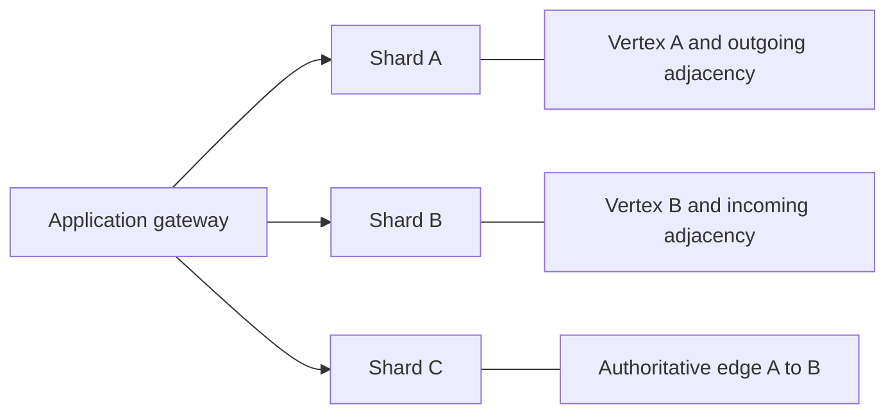
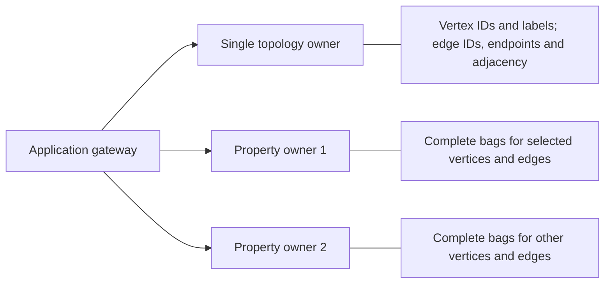

# Graph sharding and storage layouts

The Property Graph profile has two alternative physical ownership layouts. Both are implemented by the distributed composition APIs. Choosing a layout does not start a cluster: the standalone server and its Docker image remain single-node deployments.

| Layout | Topology ownership | Property ownership |
| --- | --- | --- |
| `DatabaseStorageLayout.Current` (`ProfileOwned`) | Vertices and authoritative edges are routed by immutable identity; adjacency roles follow their endpoint owners. | Properties remain in the profile-owned graph records. |
| `DatabaseStorageLayout.GraphTopologyProperties` | One logical topology owner holds vertices, labels, edge identities, endpoints and adjacency. | Complete vertex and edge property bags are routed by immutable identity across 1–32 property owners. |

These are alternatives. The split layout does **not** also distribute topology across several vertex shards. A logical owner is a storage role; it is not necessarily a separate machine. Placement and serving authority determine which physical node may operate that role.

## Profile-owned vertex and edge sharding

With the registered stable-hash routing policy, each vertex identity selects its owner. Each edge identity independently selects its authoritative owner. An edge can also have an outgoing-adjacency role at its source vertex's owner and an incoming-adjacency role at its destination vertex's owner. These roles may coincide on one shard or span several shards; they are coordinated representations of an edge, not unrelated application edges.



The diagram is one possible placement, not a requirement for three owners per edge. Traversals, writes and queries can cross owner boundaries. Applications use the distributed gateway/client APIs to coordinate that work; opening several independent local graph databases does not provide those guarantees.

This is the layout to evaluate when topology itself needs distribution. Stable hashing does not promise that highly connected vertices, large records or a particular workload will be balanced evenly.

## Separate topology and property bags

In the split layout, topology is kept together while property payloads are assigned to other owners:



A **property bag** is the complete set of properties for one vertex or one edge. For example, a vertex's `name`, `address` and `description` stay together on its selected property owner. They are not independently assigned by property name. Vertex and edge bag identities use separate routing domains.

The layout requires **one topology owner plus 1–32 property owners**, or 2–33 logical shards in total. The first shard in **ordinal identifier order** becomes the topology owner; input-array order does not select the role. The remaining identifiers define the property-owner slots.

Evaluate this layout when property payloads dominate and keeping topology together is useful for your access patterns. Queries involving both connectivity and property values still need coordinated access to the appropriate roles. The single topology owner remains a capacity and availability consideration; distributing bags does not remove it. One unusually large bag cannot be spread across several owners in this layout. Benchmark your workload before assuming a performance advantage.

## Runnable routing configuration example

The following complete console program uses public types from `EntityForge.Db.Distributed.Contracts` and its dependencies. It constructs both layouts and prints the selected owners without opening databases or contacting etcd. Add a reference to the distributed contracts project when building from source, or install a matching distributed contracts package when a release is available. Use the repository's .NET SDK version.

```csharp
using System;
using EntityForge.Db;
using EntityForge.Db.Distributed.Sharding;

Guid vertex = Guid.Parse("00000000-0000-0000-0000-000000000001");
Guid edge = Guid.Parse("00000000-0000-0000-0000-000000000002");

var profileOwned = new DistributedRoutingBinding(
    StableHashDistributedShardRouter.PlacementPolicyId,
    new ShardMapVersion(1),
    new LogicalShardId[] { new("partition-a"), new("partition-b"), new("partition-c") },
    DatabaseStorageLayout.Current);

var split = DistributedRoutingBinding.GraphTopologyProperties(
    new ShardMapVersion(1),
    new LogicalShardId[] { new("00-topology"), new("10-properties-a"), new("20-properties-b") });

Console.WriteLine($"Profile-owned vertex owner: {profileOwned.RouteGraphProperties(vertex).Value}");
Console.WriteLine($"Profile-owned authoritative edge owner: {profileOwned.RouteGraphProperties(edge, edge: true).Value}");
Console.WriteLine($"Split topology owner: {split.GraphTopologyOwner!.Value}");
Console.WriteLine($"Split vertex bag owner: {split.RouteGraphProperties(vertex).Value}");
Console.WriteLine($"Split edge bag owner: {split.RouteGraphProperties(edge, edge: true).Value}");
```

The two split bags are allowed to select the same owner. The topology owner is always `00-topology` for this configuration. The stable-hash helper selects an owner for data; it does not grant that owner permission to serve it.

For a source example project outside this repository, add a `Directory.Packages.props` beside the example project that imports the DB central package versions from `src/Db/Directory.Packages.props` and enable `CentralPackageTransitivePinningEnabled`. A project reference alone does not transfer that policy into the consuming project. This source-build requirement is separate from installing a published package's declared dependencies.

To use the chosen binding in a deployment:

1. Select **one** binding for the database generation. Use the Property Graph profile, `DatabaseProfileId.PropertyGraph`.
2. Establish placement leases and a generation-bound decision authority, passing the same binding to `PartitionDecisionAuthority.OpenEtcdAsync` and the participating nodes.
3. Create each node in its own empty data directory with `PartitionDatabaseNode.CreateAsync`, its placement lease, the binding, placement authority, decision authority and `PartitionDatabaseNodeOptions`. A healthy bounded clock is required; do not substitute an unverified clock just to make startup succeed.
4. Configure authenticated participant listeners, the complete owner directory, recovery and the application gateway using the [distributed hosting requirements](../db/HOSTING.md#distributed-query-serving-authority).
5. Use the distributed application APIs for reads and writes. Inspect execution capabilities, including `StorageLayout` and, for the split layout, `TopologyOwner`, before relying on a particular arrangement.

This is explicit application composition, not a standalone-server command-line switch or a complete production deployment manifest. The repository's public distributed API tests in `tests/Db/EntityForge.Db.Distributed.Tests` demonstrate the public composition, and the split-layout tests in `tests/Db/EntityForge.Db.Partition.Tests/PartitionOwnedNodeTests.TopologyProperties.cs` exercise its role-specific behavior. Test authorities and test clocks are fixtures, not production deployment components.

## Creation, reopening and ownership changes

The layout is a **creation-time physical ownership contract**. Its kind/version and routing fingerprint participate in persisted metadata and authority checks. Reopen a store with its matching profile, layout and routing configuration; changing an enum or directory name does not convert its contents.

Changing the property-owner count changes hash placement. Adding or renaming logical shards, switching between layouts, and moving an existing logical shard to another physical owner are different operations. Do not use an edited owner list as an automatic resharding procedure. Role-preserving ownership transfer has dedicated authority, recovery and serving-barrier requirements; it is not an automatic conversion between these two layouts.

Neither layout implies replicas, a high-availability SLA or automatic standalone-to-cluster conversion. Multiple server processes must not share a local database directory as a clustering mechanism.

## Query behavior and release maturity

Layouts control physical ownership, not the query language. GQL remains subject to the [documented language and execution limits](../user/gql.md); distributed capabilities and explain results determine which execution paths are available. Do not assume that every standalone query shape is available in every distributed layout. The Semantic profile's GQL/SPARQL views are a separate feature and do not select a Graph storage layout.

Split-layout tests cover mapped save/query/reopen, HTTPS relationship operations, mutations, retention, ownership transfer, rejection of mixed property-bag reads during partial completion, paging and conflict handling. Tests that require a live authority need their documented environment configuration; a skipped test is not validation of that behavior.

Current distributed qualification is a **local multi-process preview**, not a general cross-machine production-clustering claim. Independent-machine clocks, networks, storage failure domains and operational security need validation in the intended deployment. Follow the [distributed validation guide](distributed-validation.md) for the prerequisites and evidence boundaries.
