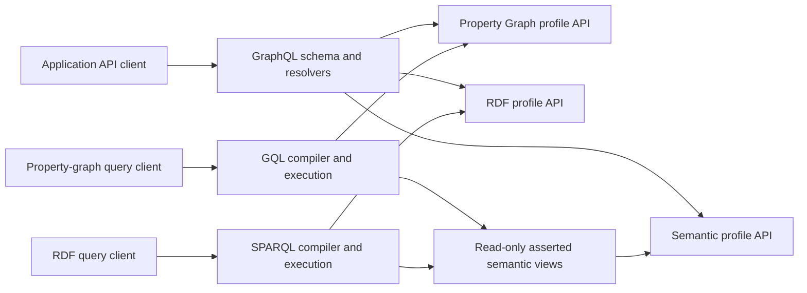

# Choosing GraphQL, GQL or SPARQL

GraphQL and the native query languages serve different developer needs. Use GraphQL to consume the fields and operations in a published application API. Use GQL or SPARQL when the caller needs to express a query directly against the corresponding database model. All three have language specifications; the distinction is their role, not whether they are standards-based.

## Choose by the question your application asks

| Developer task | Typical choice | Why |
| --- | --- | --- |
| Populate a screen with selected entity fields and supported related entities | GraphQL | The client selects a response shape from an introspectable schema, using variables, fragments and aliases. |
| Integrate a service with a stable set of domain operations | GraphQL or the typed profile API | The published operation contract defines what callers can request. |
| Find connected property-graph patterns, traverse paths, or group matching nodes and relationships | GQL | The query describes the matching and computation directly, within the supported language surface. |
| Query RDF triples and named graphs, join by IRIs, or use configured RDF federation | SPARQL | The query uses RDF terms and SPARQL dataset semantics directly. |
| Inspect semantic assertions, evidence, temporal scope and supported entailment policies | Semantic GraphQL or the Semantic profile API | Those policies are part of the current Semantic interface. |

For example, an application detail view might request a person's name and the employer relationship exposed by its GraphQL schema. A developer investigating which people connect to an organisation through several different paths may need GQL. An RDF integration that joins triples from named graphs and returns aggregate results naturally fits SPARQL.

These are typical roles, not restrictions on which kind of application may use each interface. A backend can use GraphQL, and an application service can execute parameterized GQL or SPARQL on behalf of its clients.

## What the schema controls

GraphQL lets clients choose **which exposed fields to receive**. The server's schema and resolvers define the available filtering, relationships, aggregation and mutation operations. A GraphQL selection does not introduce an arbitrary graph traversal or database join merely because the response is nested.

A schema can expose sophisticated search or aggregation fields. Their availability comes from that schema's contract; GraphQL does not automatically provide every native GQL or SPARQL operator. Conversely, a native query can project application-friendly results without requiring a GraphQL API.

For an application-facing contract, GraphQL can make recurring access patterns easy to discover and reuse. For exploration, reporting and query-driven integrations, native queries let developers express new supported combinations without first adding an API field. Both approaches require appropriate authorization, execution budgets and handling of incomplete or failed requests. The language choice does not establish an authorization policy by itself.

## Current EntityForge interfaces

| Profile | GraphQL interface | Native language |
| --- | --- | --- |
| Property Graph | Entity-oriented fields and graph mutations | GQL |
| RDF | Entity-oriented fields and RDF mutations | SPARQL |
| Semantic | Semantic queries, source-session writes and domain policies | Semantic APIs and [read-only GQL/SPARQL evidence views](../user/semantic-native-queries.md) |

GraphQL introspection exposes the active profile's schema. It does not switch the database profile or convert one data model into another. The Graph/RDF GraphQL contract exposes bounded relationships; its supported operations are not an alternative spelling of every native query feature.



The arrows show supported interface families, not simultaneous access to every profile through one request. GraphQL and native query routes use the active profile's database facilities; GraphQL is not a separate copy of the data. GQL and SPARQL retain their own value, matching and result semantics.

## Embedded graph snapshots

The .NET `IGraphDatabase` API also exposes stored graph state directly. Its
`QueryAsync` accepts a structured `BoundedGraphPatternQuery`, not GQL text.
`ReadSnapshotPageAsync` instead enumerates the vertices and edges of a leased
snapshot as creation effects; it is not a query-result page or a change-feed page.

Acquire a snapshot lease, keep it alive while following each `NextCursor`, and
dispose it when enumeration finishes. A page size must be between 1 and 1,000
entities; the default is 256. Larger requests fail explicitly. Follow the
continuation until it is null to retrieve the complete snapshot. The page-size
limit is not a limit on the complete dataset, and vertices precede edges.
Continuations belong to the database instance and snapshot version: do not
fabricate them, switch snapshots midway, or reuse them after reopening a database.

For initial replication followed by changes, `AcquireChangeBootstrapAsync`
captures the snapshot and its corresponding change cursor together. Resume
changes strictly after that cursor. A snapshot lease protects snapshot state,
not change-feed retention; if the change cursor expires while the consumer is
bootstrapping, start a new bootstrap rather than accepting a gap. Merely retaining
a version number from a query response does not retain its snapshot.

## Embedded RDF snapshots

The .NET `IRdfDatabase.Find` API matches an `RdfQuadPattern`; it does not parse
SPARQL. For repeated reads of one retained view, acquire an `RdfSnapshotLease`
from that database and dispose it after the reads finish. A lease belongs to the
database instance that created it. Passing it to another database fails even if
both databases report the same version number. A disposed lease cannot be reused.

For larger enumerations, `QueryPageAsync` returns bounded pages of matching
quads. Request between 1 and 1,000 quads per page and follow the continuation
using the same pattern. Continuations retain server-side state and advance that
state; they are not replay tokens. If a page response is lost and its outcome is
uncertain, restart the enumeration rather than assuming a retry repeats the page.
Complete the enumeration or release its continuation when abandoning it. Expiry
and database disposal also release the retained read.

RDF transactions capture their mutation and optimistic-read collections. Each
collection accepts at most 10,000,000 entries, and the encoded transaction must
fit within 512 MiB. These are transaction-format limits, not a process-memory
budget or a recommended batch size. Encoding rejects oversized payloads before
growing its buffer beyond that bound. Caller-owned data, captured collections,
the returned encoded copy and storage preparation consume additional memory.
For large imports, use bounded document pages and retain their document/page
identities for retries. Each page commits independently; it does not make the
entire document one atomic transaction.

Initial `BulkLoadAsync` preparation has a separate configurable budget. The
defaults admit 100,000 input quads and 64 MiB of charged preparation per load.
Duplicate quads still consume both budgets. A rejected load publishes nothing
and releases write admission; it does not leave a partially loaded dataset.
Configure a larger envelope explicitly when the deployment has sufficient memory:

```csharp
await using var database = await RdfDatabase.OpenLocalAsync(new("rdf-data")
{
    BulkLoad = new RdfBulkLoadOptions
    {
        MaximumInputQuads = 1_000_000,
        MaximumChargedBytes = 512L * 1024 * 1024
    }
});
```

The allowed maximums are 10,000,000 input quads and 4 GiB of charged preparation.
Each quad costs 256 structural bytes plus its term encoding estimate: one byte
per term, five prefix bytes per string and the string's UTF-8 bytes. Named graphs,
literal datatypes/languages and nested quoted triples also count. This charge is
an admission estimate, not a total-memory guarantee. Raising it does not raise
the transaction-format limit or remove physical-storage limits. The options are
runtime settings; reopening an existing database can use a different envelope.

## Semantic data and AI applications

An application's knowledge model comes from its data model, vocabulary and semantic policies. GraphQL's object types describe an API response contract; they do not by themselves define an ontology or an inference regime. GQL and SPARQL likewise depend on the database's supported semantics for any inferred facts they expose.

For an AI application, GraphQL can expose a constrained, discoverable set of useful operations. Native queries can support more flexible graph exploration and evidence retrieval. Neither interface alone guarantees an accurate answer. Preserve the meaning of returned evidence, policy choices and query limits when using results as model context.

## Contracts and examples

- [Graph/RDF GraphQL schema contract](../db/PROFILE_GRAPHQL_DESIGN.md)
- [Semantic GraphQL schema contract](../db/SEMANTIC_GRAPHQL_DESIGN.md)
- [GQL queries and updates](../user/gql.md)
- [SPARQL and query-language capabilities](../user/query-languages.md)
- [Studio query workflows](../user/studio-queries.md)
- [Query compatibility and qualification](query-compatibility.md)

Check the connected server's schema and capability response. EntityForge's current native language implementations are previews with documented limits; a successful GraphQL operation is not evidence that an equivalent native query, or the reverse, is supported.
