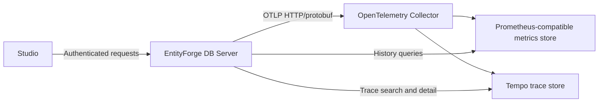

# Metrics, history and query traces

Studio distinguishes current runtime observations from externally retained telemetry. Opening a panel does not enable collection. Configure export and the read backends on the server before expecting historical charts or captured query traces.



The collector and backends are separately operated services. The database's local Compose example does not deploy them.

## Configure export

Set these values in the server process environment and restart it:

| Variable | Meaning |
| --- | --- |
| `OTEL_EXPORTER_OTLP_ENDPOINT` | HTTP(S) **base URL** of the collector's OTLP HTTP receiver |
| `OTEL_METRIC_EXPORT_INTERVAL` | Positive export interval in milliseconds; default 5000 |
| `ENTITYFORGE_OBSERVABILITY_INSTANCE` | Optional stable instance identifier using 1–128 letters, digits, underscores, dots or hyphens |
| `ENTITYFORGE_PROMETHEUS_URL` | Server-reachable Prometheus-compatible query API base URL |
| `ENTITYFORGE_TEMPO_URL` | Server-reachable Tempo query API base URL |

The exporter appends `v1/traces` and `v1/metrics` to the OTLP base URL and uses HTTP/protobuf. Do not supply a gRPC-only receiver or append a signal path yourself. The base URL must not contain embedded credentials, a query string or a fragment. When the export endpoint is absent, the standalone host does not start the OTLP exporters.

For example, with services already configured on an isolated local environment:

```powershell
$env:OTEL_EXPORTER_OTLP_ENDPOINT = 'http://127.0.0.1:4318'
$env:OTEL_METRIC_EXPORT_INTERVAL = '5000'
$env:ENTITYFORGE_OBSERVABILITY_INSTANCE = 'evaluation-db'
$env:ENTITYFORGE_PROMETHEUS_URL = 'http://127.0.0.1:9090'
$env:ENTITYFORGE_TEMPO_URL = 'http://127.0.0.1:3200'
```

These addresses are examples, not services started by EntityForge. Inside a container, `127.0.0.1` refers to that container; use the appropriate service-network names instead.

Keep the instance identifier distinct for independently running databases. If omitted, the standalone server derives it from the machine, absolute data directory and profile. Moving that deployment can therefore change the derived identity. Use an explicit stable value when continuity matters, and do not reuse it across unrelated concurrent instances.

## Preserve the resource labels

The exported service name is `EntityForge.Db.Server`. Studio's history adapter selects Prometheus series using `service_name` and `service_instance_id`. Configure the collector/metrics export so those labels retain the service name and the configured instance identity. An otherwise healthy metrics pipeline with different labels can still produce an empty Studio history view.

Trace search selects the matching `resource.service.name` and `resource.service.instance.id` and query spans tagged `entityforge.query = true`. Preserve those resource attributes and span tags. The profiler is a bounded query-trace viewer, not a browser for every HTTP request or all telemetry in the backend.

## Check the complete path

1. Confirm that the server can reach the collector and each configured read backend.
2. Run a supported query against the database.
3. Allow export and scrape/ingestion intervals to elapse.
4. Inspect the backend directly for the expected service and instance labels.
5. In Studio, refresh **Telemetry → History** or select **Search** in **Query Profiler**.
6. Open a trace to inspect its spans, timing and outcome; use **Back to traces** to return to search.

Historical rates require enough samples, and percentile displays require the expected histogram series. A very short range immediately after startup can show no usable rate. Export delay, retention, sampling and backend failures all affect what appears. No result does not prove that no query ran.

## Interpret database measurements

The `EntityForge.Db` meter reports operation observations, not an independent
transaction ledger. `entityforge.db.commits` includes both applied commits and
idempotent replays of `db.commit`; use the `entityforge.db.outcome` tag to separate
them before calculating newly applied transaction rates. Failure and conflict
counters can describe the same operation, so adding them does not necessarily
give a count of distinct failed requests.

Operation, commit-queue, publication and planning-stage duration histograms use
milliseconds. Queue depth, checkpoint version and WAL segment/byte instruments
are sampled histograms, not continuously updated gauges. Their last observation
may be stale, and summing their samples does not give current queue depth, database
version or retained log size. Checkpoint size is omitted when unknown; absence is
not a zero-byte checkpoint.

Planning-stage allocated bytes measure growth of the process-wide allocation
counter. Concurrent work can contribute to that delta. It is neither isolated
per-query allocation nor retained live memory and cannot establish a memory-leak
or endurance verdict by itself.

## Operational limits

History and trace searches accept lookback windows from one minute through 24 hours.
Trace search returns at most 100 results; a reached-limit flag means more matches
may exist. Narrow the time window or raise the minimum duration to refine a search.
Trace detail returns at most 500 spans and reports truncation explicitly. It includes
only the selected server instance, so a span's parent may belong to an omitted
service. Displayed span offsets start at the earliest selected span, not necessarily
the beginning of the complete distributed trace.

History samples can be missing or null; treat these as gaps rather than measured
zeroes. A configured history or trace backend is not proof of backend health or of
retained data. Request failures must remain distinct from successful empty results.

The browser queries the authenticated database host; it does not receive a general-purpose Prometheus/Tempo proxy. Backend addresses remain server-side. Restrict their network exposure independently and protect their retention, since telemetry can reveal operational metadata.

Studio can refresh or search available telemetry but cannot reconstruct traces that were never exported or were already deleted. The built-in trace configuration excludes health, Studio asset and observability polling routes from ASP.NET request tracing to reduce self-generated noise. Use database/application outcome records, not telemetry alone, to decide whether a write committed.
